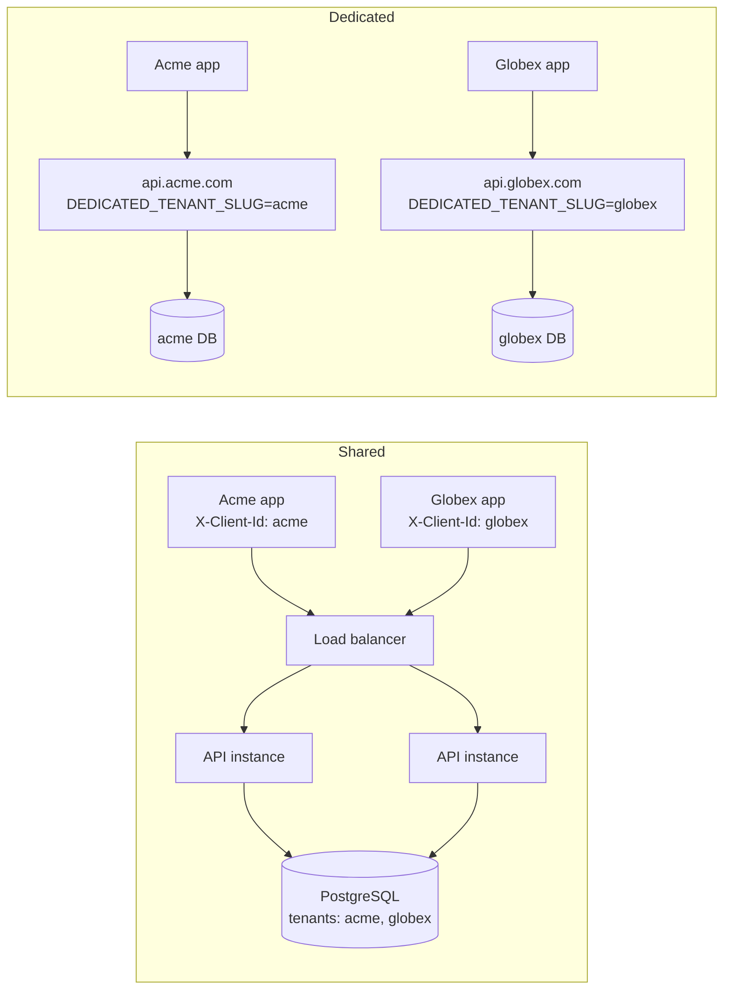
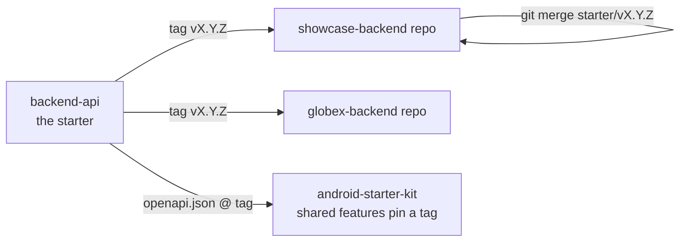
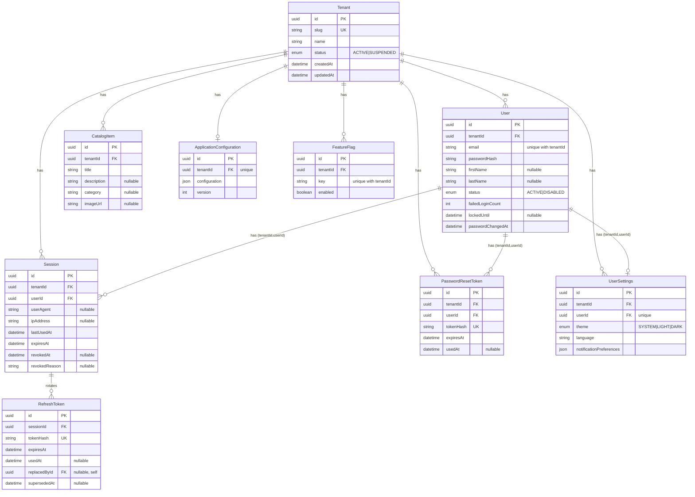
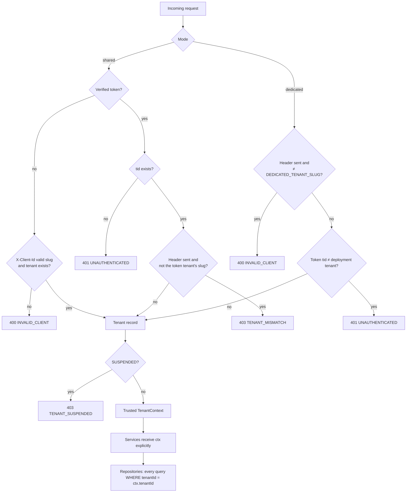
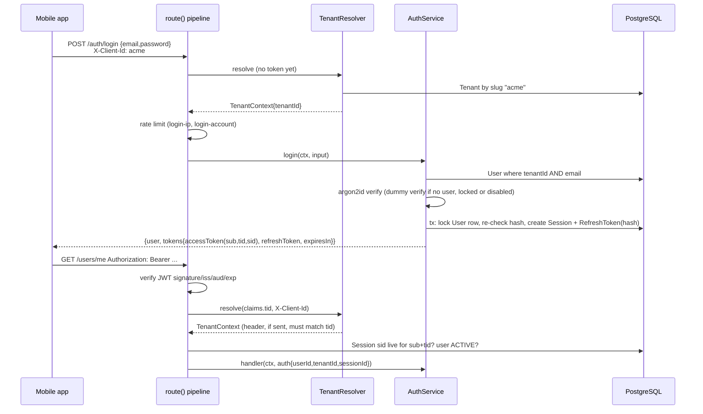

# Architecture

## Overview

A multi-tenant REST API (Next.js 16 route handlers, TypeScript, Prisma 7, PostgreSQL) that is the
starter for every app's backend (see [Role of this repo](#role-of-this-repo)). The contract is the
committed [`openapi/openapi.json`](../openapi/openapi.json) (see [api.md](./api.md) and
[contract.md](./contract.md)).

One image runs in two modes, chosen by `DEPLOYMENT_MODE` at startup:

- **Shared:** one instance and one database serve many tenants; each request names its tenant with
  `X-Client-Id` (the tenant slug), and after login the tenant is the signed `tid` claim.
  See [deployment-shared.md](./deployment-shared.md).
- **Dedicated:** one deployment (own database, `JWT_SECRET`, domain) serves exactly one tenant, fixed by
  `DEDICATED_TENANT_SLUG`. This is the normal production shape. See
  [deployment-dedicated.md](./deployment-dedicated.md).



## Role of this repo

This repo is **the backend starter**. Each app built from `android-starter-kit` gets its own backend:
a repo cloned from this one, which keeps a `starter` remote and pulls updates by merging starter tags
([creating-a-backend.md](./creating-a-backend.md)). The shared Android features call the starter's API
directly, with no adapter layer, so that API is a shared dependency of every app and every backend made
from it. `/api/v1` is extend-only, and app backends add their own endpoints under `/api/v1/x/`
([contract.md](./contract.md)).

Dedicated mode is the normal production shape. Shared mode is supported for local development and for
running several small apps cheaply.



## Folder structure

```
src/
  app/api/v1/        route.ts files only (thin: each is a route({...}) call)
  instrumentation*.ts startup config validation
  core/
    config/          env schema, loadConfig()
    container.ts     composition root (wires repositories, services, caches)
    database/        Prisma client factory, Prisma error mapping
    errors/          AppError, error codes -> HTTP status
    http/            route() pipeline, envelopes, request id, client IP, body reader, health DTO
    logging/         pino logger with redaction
    rate-limit/      RateLimiter interface + in-memory fixed-window implementation
    tenant/          TenantContext, shared/dedicated resolvers, tenant repository + cache, admin service
    auth/            JWT, password hashing, opaque tokens, per-request session check
    validation/      common Zod schemas (email, password, uuid, pagination)
    openapi/         registry, shared components, system routes
  modules/           auth, users, settings, catalog, app-config, mail
  shared/            tiny pure helpers (clock)
  generated/prisma/  generated Prisma client (do not edit)
prisma/              schema.prisma, migrations/, seed.ts
scripts/             generate-openapi.ts, tenant.ts (operator CLI), commit/CI helpers
openapi/             openapi.json (generated, committed)
tests/               unit/, integration/, helpers/, setup/
docs/                this documentation
docker/              postgres-init.sql (local databases)
```

A request flows `route.ts` -> `route()` (tenant, auth, parse, rate limit) -> `<module>.handlers.ts` ->
`<module>.service.ts` -> `<module>.repository.ts` -> Prisma.

## Module boundaries

| Module | Owns | Does not own |
| --- | --- | --- |
| `core/config` | Parse and validate env; typed `AppConfig` | Business rules |
| `core/tenant` | `TenantContext`; shared and dedicated resolvers; tenant lookup with 30 s cache; tenant admin service (used by the CLI) | Tenant CRUD over HTTP (none exists) |
| `core/auth` | Sign/verify access JWTs; hash/verify passwords; opaque tokens; per-request session check | Login and registration flows |
| `core/http` | `route()` pipeline; success/error envelopes; request id; client IP | Business logic |
| `core/rate-limit` | `RateLimiter` interface; in-memory fixed window | Distributed limiting (swap in Redis behind the interface) |
| `modules/auth` | Register, login, refresh rotation and reuse detection, logout, forgot/reset password, sessions, lockout | Profile edits |
| `modules/users` | Own profile, change password | Tokens |
| `modules/settings` | Per-user theme, language, notification preferences (created lazily with defaults) | App-wide defaults |
| `modules/catalog` | Tenant-scoped list (page, search, filter, sort) and detail; the template for new modules | - |
| `modules/app-config` | Public per-tenant config document (validated JSON, allowlisted output) and feature flags | Android build-time branding |
| `modules/mail` | `Mailer` interface, `ConsoleMailer` | A real provider (none yet) |

Rules: handlers contain no tenancy logic; services receive the `TenantContext` explicitly; only
repositories touch Prisma; DTO mappers are explicit allowlists. See [adding-a-module.md](./adding-a-module.md).

## Data model

Matches `prisma/schema.prisma`. Every tenant-owned table carries `tenant_id`; child tables reference
`(tenant_id, id)` of `users` with composite foreign keys so a row can never point at another tenant's user.



A `Session` is the revocable unit (one per login); each refresh rotation adds a `RefreshToken` row to the
same session, marks the previous one used and links it to its successor (`replacedById`); a
lost-response retry marks the unused successor `supersededAt` instead. Ids are UUIDv7. `RefreshToken` has no tenant column: it is
reached only through its session, which is tenant-scoped.

## Tenant resolution

Every request is bound to exactly one tenant before any business code runs. Client input is never
trusted on its own: a slug is checked against the database (or deployment config) and the tenant
claim is trusted only from a signature-verified JWT.

Resolver outcomes (`src/core/tenant/shared-resolver.ts`, `dedicated-resolver.ts`, `resolver.ts`).
"Token" means a signature-verified bearer token carrying `tid`.

| Mode      | Token                               | `X-Client-Id`                               | Result                                                                                                     |
| --------- | ----------------------------------- | ------------------------------------------- | ---------------------------------------------------------------------------------------------------------- |
| shared    | no                                  | missing                                     | 400 `INVALID_CLIENT`                                                                                       |
| shared    | no                                  | malformed or unknown slug                   | 400 `INVALID_CLIENT`                                                                                       |
| shared    | no                                  | known slug                                  | tenant from header                                                                                         |
| shared    | yes, tenant exists                  | none, or the token tenant's slug            | tenant from token                                                                                          |
| shared    | yes, tenant exists                  | anything else (other, unknown or malformed) | 403 `TENANT_MISMATCH`                                                                                      |
| shared    | yes, `tid` unknown                  | any                                         | 401 `UNAUTHENTICATED`                                                                                      |
| dedicated | no                                  | none or `DEDICATED_TENANT_SLUG`             | the deployment tenant                                                                                      |
| dedicated | any                                 | any other value                             | 400 `INVALID_CLIENT` (checked before the token)                                                            |
| dedicated | yes, `tid` is the deployment tenant | none or matching                            | the deployment tenant                                                                                      |
| dedicated | yes, `tid` is another tenant        | none or matching                            | 401 `UNAUTHENTICATED`                                                                                      |
| any       | any                                 | any                                         | resolved tenant is `SUSPENDED`: 403 `TENANT_SUSPENDED` (checked last, only for an otherwise valid request) |



**Caching and suspension.** Tenant lookups are cached in memory for 30 s (`CachedTenantLookup`;
misses are never cached). The CLI runs as a separate process and does not touch the server's
cache, so suspending a tenant takes effect on running servers within 30 s.

**Where enforcement lives.**

- `route()` (`src/core/http/route.ts`) is the only place a `TenantContext` is created, by calling the
  mode's resolver (`src/core/tenant/`). Route handlers contain no tenancy logic.
- Every tenant-owned repository method takes `tenantId` as its first parameter and filters by it;
  lookups by id use `findFirst({ where: { id, tenantId } })`, so a foreign id is "not found".
- The database adds composite foreign keys and tenant-scoped unique constraints as a backstop.
- Postgres RLS (`SET LOCAL app.tenant_id`) is deferred as a future hardening step because it needs
  every query inside a transaction.

Tenants are managed by the operator CLI (`npm run tenant`, see
[local-development.md](./local-development.md)); there is no admin HTTP API.

## Authentication

Email and password accounts, scoped to one tenant (`User` is unique on `(tenantId, email)`).
Sessions are the revocable unit; tokens are just credentials for a session.

**Token model**

- **Access token:** a JWT signed HS256 with `JWT_SECRET`. Claims: `sub` (user id), `tid` (tenant id),
  `sid` (session id), plus `iss` (`JWT_ISSUER`), `aud` (`whitelabel-api`), `iat`, `exp`. TTL is
  `ACCESS_TOKEN_TTL_SECONDS` (default 900 s). The tenant claim is trusted only from a verified token.
- **Refresh token:** 32 random bytes, base64url. Only its SHA-256 hex is stored (`RefreshToken.tokenHash`);
  the plain value is returned once and never logged.
- **Session:** one per login, `REFRESH_SESSION_TTL_DAYS` (default 30) absolute lifetime. It holds the
  user agent and IP and can be revoked with a reason (`logout`, `user_revoked`, `password_reset`,
  `password_changed`, `refresh_token_reuse`). Rotating a refresh token does not extend it.
- **Passwords:** Argon2id (memoryCost 19456, timeCost 2, parallelism 1), 10 to 128 characters.



**Per-request session check.** For every `auth: "required"` route, `route()` verifies the JWT, resolves
the tenant, then `PrismaSessionCheck` loads the session by `(sid, sub, tid)` and requires it to be not
revoked, not expired, and its user `ACTIVE`; otherwise `401 UNAUTHENTICATED`. This is one indexed query
per request, and it makes logout, password change and disabling a user effective immediately instead of
after the access token expires. `lastUsedAt` is refreshed at most every 5 minutes.

**Refresh rotation and reuse detection** (`AuthService.refresh`). Each refresh token is single use.

1. Look up by hash. Unknown, another tenant's, expired, or belonging to a revoked or expired session or
   a non-active user: `401 INVALID_REFRESH_TOKEN`. A token from another tenant never revokes anything.
2. A superseded token (`supersededAt` set, see 4) is rejected with `401`; the session is kept (it was
   issued but replaced, which is not evidence of theft).
3. Unused token: in one transaction, atomically claim it (`usedAt` set only if it is still unused and
   unsuperseded), create the successor S (same session expiry), set `replacedById = S` and touch the
   session. S's pair is returned. A lost claim falls through to 4/5 using the token's committed state.
4. Used less than 10 s ago (a lost-response retry or a race): if the successor S is still unused and
   unsuperseded, atomically supersede it (`updateMany ... usedAt IS NULL AND supersededAt IS NULL`, count
   1), create S2, point `replacedById` at S2 and return S2's pair. If S was already used or the supersede
   loses a race, reject with `401` and keep the session.
5. Used 10 s ago or more: treated as theft; the session is revoked with reason `refresh_token_reuse` and
   `401` is returned.

Invariant: a session has at most one live (unused, unsuperseded) refresh token, and it belongs to the
last pair handed out; a replay within the grace window never revokes the session. Two simultaneous
refreshes with one token may both return 200, but only the later pair works. Clients must still
serialize refreshes (single flight). Trade-off: someone holding a stolen token who uses it within 10 s
of the legitimate refresh, before the new token is used, gets the live pair and the legitimate client's
pair is superseded (it gets `401` without revocation and the user signs in again).

**Lockout and enumeration protections**

- 10 consecutive failed logins lock the account for 15 minutes (DB-backed, so it holds across
  instances). A locked, disabled or unknown account returns the same `401 INVALID_CREDENTIALS` as a
  wrong password, and each of those paths spends one Argon2 verification (a dummy one when no hash is
  available) to equalize timing. A successful login clears the counter.
- A login racing a password reset cannot leave a session that survives the reset: the transaction that
  creates the session locks the user row (`SELECT ... FOR UPDATE`) and aborts with `401
  INVALID_CREDENTIALS` if the password hash or `passwordChangedAt` changed since the password was
  verified (or the user is no longer `ACTIVE`). A reset that is still committing makes the login wait
  and then fail.
- Forgot-password always answers `202 {}` and swallows mail errors.
- Reset tokens: 32 random bytes, SHA-256 stored, 30 min expiry, single use, looked up per tenant. A
  reset updates the password, revokes all sessions and clears the lockout. Requesting a new token
  invalidates earlier ones.
- Changing a password (`PATCH /users/me/password`) requires the current password and revokes every
  other session, keeping the caller's.

**Account lifecycle**

Register creates the user and the first session. Deleting the account (`DELETE /users/me`) is a hard
delete, confirmed with the current password (`401 INVALID_CREDENTIALS` otherwise, before anything is
touched). A single `delete` of the user row relies on the schema's `onDelete: Cascade` relations to remove
the user's sessions (and their refresh tokens), password reset tokens and settings, in one atomic
statement. The delete is conditional on what was verified: the same `passwordChangedAt` and a live
caller session. A password change, reset or revocation that commits between the check and the delete
wins (`401 INVALID_CREDENTIALS` or `401 UNAUTHENTICATED`, nothing deleted), and a concurrent duplicate
request that finds the account already gone returns 200. Catalog items, app config and flags are tenant-owned and untouched; there is no audit table.
Because every authenticated request checks the session in the database, the next request with the old
access token is `401 UNAUTHENTICATED`, and the old refresh token is `401 INVALID_REFRESH_TOKEN`. The
email is free to register again as a new account. There is no soft delete or recovery.

**Rate limits** (in `auth.handlers.ts` and `users.handlers.ts`, evaluated by `route()` after input parsing; `429
RATE_LIMITED` with `Retry-After`). IP rules use `ipKey`, which skips the rule when the IP is unknown.
Rules run in list order and the first rejection stops evaluation, so every list puts its IP rules first:
a blocked IP never creates body-keyed (email) buckets. The in-memory limiter holds at most 100,000 keys
(`maxEntries`); at the cap it drops expired keys, then the oldest ones.

| Rule name        | Route                                      | Limit / window | Key                 |
| ---------------- | ------------------------------------------ | -------------- | ------------------- |
| `register-ip`    | POST /auth/register                        | 5 / 1 h        | IP                  |
| `login-ip`       | POST /auth/login                           | 10 / 60 s      | IP                  |
| `login-account`  | POST /auth/login                           | 5 / 60 s       | tenant id + email   |
| `refresh-ip`     | POST /auth/refresh                         | 30 / 60 s      | IP                  |
| `forgot-ip`      | POST /auth/forgot-password                 | 10 / 15 min    | IP                  |
| `forgot-account` | POST /auth/forgot-password                 | 3 / 15 min     | tenant id + email   |
| `reset-ip`       | POST /auth/reset-password                  | 10 / 15 min    | IP                  |
| `password-check` | PATCH /users/me/password, DELETE /users/me | 5 / 15 min     | tenant id + user id |

Differences from the original design: `login-account` is keyed by tenant and email, not IP and email, so
distributed guessing is also limited; logout, `/auth/me`, sessions and the other `/users/me` routes have
no rate limit of their own. `password-check` is one bucket shared by both routes that check the current
password, so a stolen access token gets 5 guesses per 15 minutes in total, not 5 per route.

**Security notes**

- `POST /auth/register` returns `409 EMAIL_ALREADY_REGISTERED`, a known account-enumeration vector
  (a mobile UX trade-off); it is rate limited per IP.
- IP-based limits only work with `TRUST_PROXY=true` behind a proxy; the client IP is the `TRUST_PROXY_HOPS`-th
  `X-Forwarded-For` entry from the right (client-sent entries further left are ignored).
  Without it the IP is unknown and those rules are skipped (a warning is logged in production).
  Account-keyed rules still apply.
- Rate limits are in memory and per instance: with N instances the effective limit is up to N times
  higher. Account lockout is in the database and is not affected.
- Forgot-password has a timing difference (an existing account does database writes and a mail send).
  Send the mail asynchronously before a real mail provider is added; the current console mailer only logs.

## Follow-up: Postgres row-level security

Not built; app-level scoping plus composite foreign keys are the current isolation. Plan for adding RLS
as defense in depth:

1. Use two roles: a migration owner role, and a non-owner, non-`BYPASSRLS` app role the server connects as.
2. Add `ENABLE` and `FORCE ROW LEVEL SECURITY` plus a policy `USING (tenant_id = current_setting('app.tenant_id')::uuid)`
   on every table with `tenant_id`; give `refresh_tokens` a policy through its session.
3. Run every request's queries inside one interactive transaction that starts with
   `SELECT set_config('app.tenant_id', $1, true)` (equivalent to `SET LOCAL`). This is the real cost:
   repositories must take a transaction client, and pre-tenant lookups (tenant by slug, refresh-token
   lookup by hash) need a deliberately scoped exemption.
4. Run the existing isolation suites with RLS on, then add tests that query without setting the variable
   and expect zero rows.
