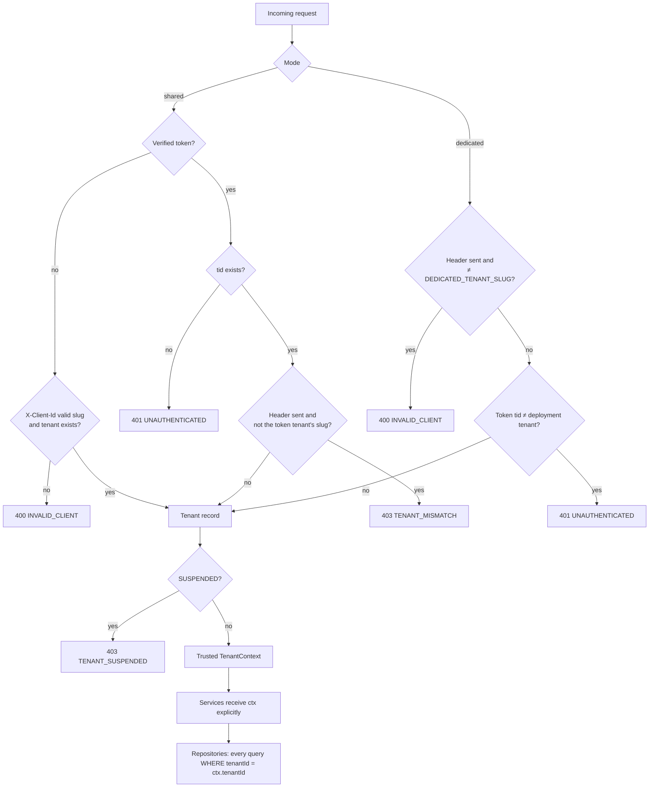

# Architecture

## Tenant resolution

Every request is bound to exactly one tenant before any business code runs. Client input is never
trusted on its own: a slug is checked against the database (or deployment config) and the tenant
claim is trusted only from a signature-verified JWT.

Resolver outcomes (`src/core/tenant/shared-resolver.ts`, `dedicated-resolver.ts`, `resolver.ts`).
"Token" means a signature-verified bearer token carrying `tid`.

| Mode | Token | `X-Client-Id` | Result |
|---|---|---|---|
| shared | no | missing | 400 `INVALID_CLIENT` |
| shared | no | malformed or unknown slug | 400 `INVALID_CLIENT` |
| shared | no | known slug | tenant from header |
| shared | yes, tenant exists | none, or the token tenant's slug | tenant from token |
| shared | yes, tenant exists | anything else (other, unknown or malformed) | 403 `TENANT_MISMATCH` |
| shared | yes, `tid` unknown | any | 401 `UNAUTHENTICATED` |
| dedicated | no | none or `DEDICATED_TENANT_SLUG` | the deployment tenant |
| dedicated | any | any other value | 400 `INVALID_CLIENT` (checked before the token) |
| dedicated | yes, `tid` is the deployment tenant | none or matching | the deployment tenant |
| dedicated | yes, `tid` is another tenant | none or matching | 401 `UNAUTHENTICATED` |
| any | any | any | resolved tenant is `SUSPENDED`: 403 `TENANT_SUSPENDED` (checked last, only for an otherwise valid request) |

**Caching and suspension.** Tenant lookups are cached in memory for 30 s (`CachedTenantLookup`;
misses are never cached). The CLI runs as a separate process and does not touch the server's
cache, so suspending a tenant takes effect on running servers within 30 s.

**Where enforcement lives.**
- `route()` (`src/core/http/route.ts`) is the only place a `TenantContext` is created, by calling the
  mode's resolver (`src/core/tenant/`). Route handlers contain no tenancy logic.
- Every tenant-owned repository method takes `tenantId` as its first parameter and filters by it;
  lookups by id use `findFirst({ where: { id, tenantId } })`, so a foreign id is "not found".
- The database adds composite foreign keys and tenant-scoped unique constraints as a backstop.
- Postgres RLS (`SET LOCAL app.tenant_id`) is deferred as a future hardening step because it needs
  every query inside a transaction.

Tenants are managed by the operator CLI (`npm run tenant`, see
[local-development.md](./local-development.md)); there is no admin HTTP API.

More sections: auth flow (Phase 4), and further modules in later phases.
