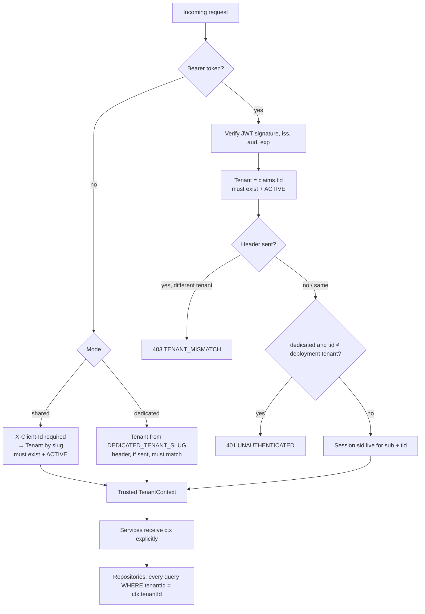

# Architecture

## Tenant resolution

Every request is bound to exactly one tenant before any business code runs. Client input is never
trusted on its own: a slug is checked against the database (or deployment config) and the tenant
claim is trusted only from a signature-verified JWT.

| Mode | No bearer token | Bearer token |
|---|---|---|
| `shared` | `X-Client-Id` (tenant slug) is required; tenant must exist and be `ACTIVE` | Tenant = `claims.tid` (must exist and be `ACTIVE`); an `X-Client-Id` naming a different tenant gives `403 TENANT_MISMATCH` |
| `dedicated` | Tenant = `DEDICATED_TENANT_SLUG`; a sent `X-Client-Id` must match it | Tenant = `claims.tid`, which must equal the deployment tenant (else `401 UNAUTHENTICATED`) |

**Caching and suspension.** Tenant lookups are cached in memory for 30 s (`CachedTenantLookup`;
misses are never cached). Suspending a tenant with the CLI therefore takes effect within 30 s on
running servers (immediately in-process, where the cache is invalidated on change).

**Where enforcement lives.**
- `route()` (`src/core/http/route.ts`) is the only place a `TenantContext` is created, by calling the
  mode's resolver (`src/core/tenant/`). Route handlers contain no tenancy logic.
- Every tenant-owned repository method takes `tenantId` as its first parameter and filters by it;
  lookups by id use `findFirst({ where: { id, tenantId } })`, so a foreign id is "not found".
- The database adds composite foreign keys and tenant-scoped unique constraints as a backstop.
- Postgres RLS (`SET LOCAL app.tenant_id`) is deferred as a future hardening step because it needs
  every query inside a transaction.

Tenants are managed by the operator CLI (`npm run tenant`, see
[local-development.md](./local-development.md)); there is no admin HTTP API.

More sections: auth flow (Phase 4), and further modules in later phases.
