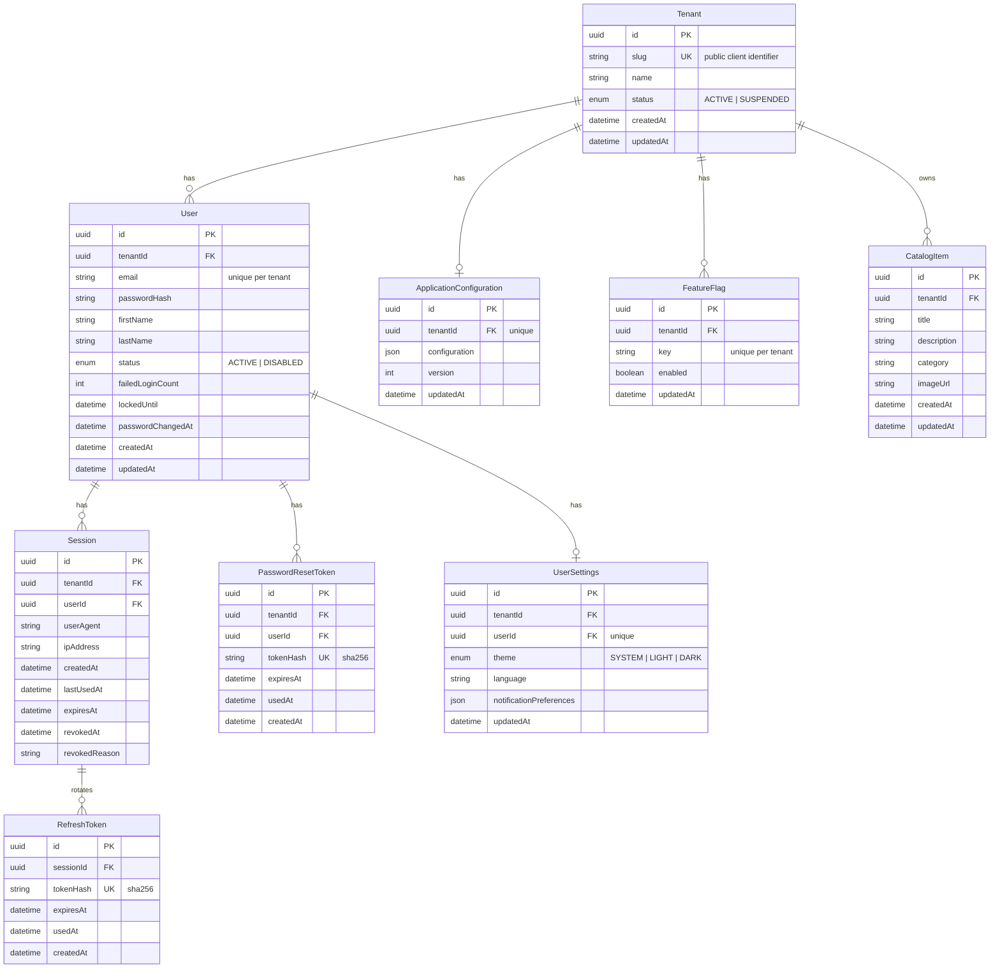
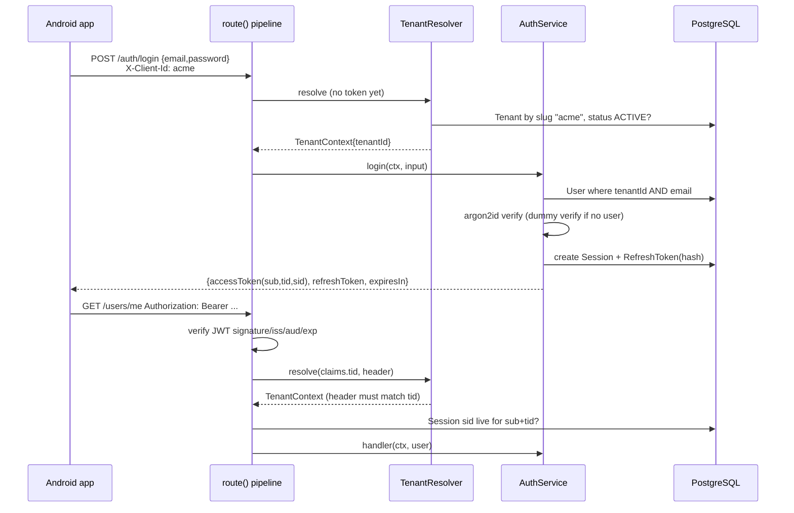
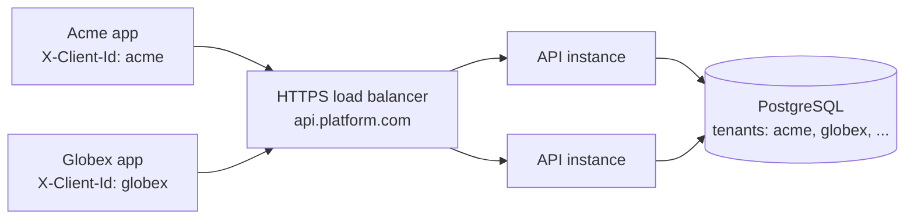
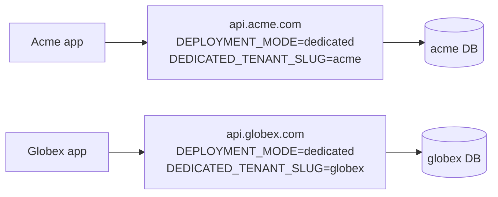
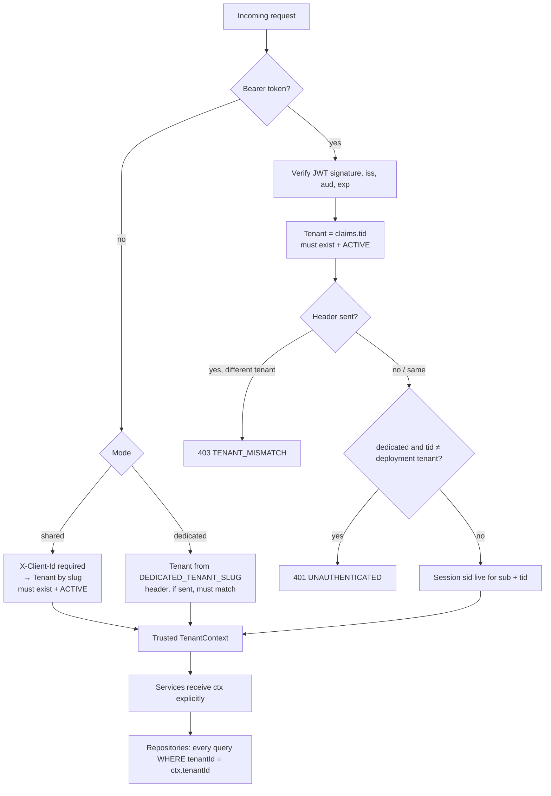

# White-Label Backend API — Architecture Design

Status: **awaiting architectural approval** (brief §20). Date: 2026-11-09.

This document answers the 11 items the brief asks for before implementation. Items
marked **(call)** are decisions I made where the brief left a choice; each is open to
correction.

---

## 0. Intent

One Next.js + TypeScript codebase that powers many white-label Android apps
(Kotlin/Compose) in either of two deployment modes:

- **shared** — many tenants, one deployment, one PostgreSQL database.
- **dedicated** — one tenant per deployment, its own database, secrets, domain, lifecycle.

Same source, same Prisma schema, same API contract in both modes. Business modules never
know which mode they run in.

**Goals:** auth, users, settings, catalog (reference module), app config, feature flags;
tenant isolation as the critical acceptance criterion; an OpenAPI contract consumed by the
separate Android repo; CI that catches isolation and auth regressions.

**Non-goals (initial scope):** web frontend, admin dashboard, admin HTTP API (tenant
management is a CLI), social/OAuth login (designed-for, not built), real email provider
(interface + console mailer), PostgreSQL RLS (documented as a follow-up; see §8), Redis.

**Anti-goals:** any code path where a tenant ID from the client is trusted without
validation; per-mode `if` branches inside business modules; stack traces or Prisma errors
reaching clients; abstractions with one implementation and no reason to exist.

---

## 1. Proposed architecture

Layered, module-per-feature, with a thin HTTP edge:

```
HTTP request
  └─ src/app/api/v1/**/route.ts        (Next.js route handler: 1–3 lines)
       └─ core/http/route()            (pipeline: request-id → logging → error mapping
            │                            → rate limit → tenant resolution → auth → Zod validation)
            └─ modules/<x>/<x>.handlers.ts   (maps validated input → service call → envelope)
                 └─ modules/<x>/<x>.service.ts    (business rules; pure TS, unit-testable)
                      └─ modules/<x>/<x>.repository.ts  (Prisma; every tenant-owned query
                                                          takes tenantId and filters by it)
```

- **Composition root:** `src/core/container.ts` builds config, Prisma, repositories and
  services once per process. Tests build their own container with a different config.
- **Startup validation:** `src/instrumentation.ts` (`register()`) loads and validates env
  with Zod and, in dedicated mode, verifies the configured tenant exists and is ACTIVE.
  Invalid config → process exits before serving traffic.
- **Runtime:** all API routes run on the Node.js runtime (argon2 is native). No Next.js
  `middleware.ts` — the `route()` wrapper is the single central enforcement point.

### Technology choices (call)

| Concern | Choice | Why |
|---|---|---|
| Runtime | Node.js 24 LTS | Current LTS line |
| Framework | Next.js 16 App Router, `output: "standalone"` | brief; standalone gives a small Docker image |
| ORM | Prisma 7 + `@prisma/adapter-pg` | brief; current major |
| Validation | Zod 4 | brief |
| OpenAPI | `@asteasolutions/zod-to-openapi` 8 (generated from the same Zod schemas) | one source of truth for validation and contract |
| JWT | `jose` (HS256) | maintained, standards-compliant |
| Password hash | `@node-rs/argon2` (Argon2id, m=19456 KiB, t=2, p=1 — OWASP) | prebuilt binaries, no node-gyp |
| Logging | `pino` with redaction | structured JSON, fast |
| Tests | Vitest | fast, TS-native |
| Spec lint | `@redocly/cli lint` | CI contract validation |

Exact versions are pinned at install time to the latest release of each major that is at
least two weeks old.

---

## 2. Folder structure

```
backend-api/
├── src/
│   ├── app/api/v1/                 # route.ts files only — thin
│   │   ├── auth/{register,login,refresh,logout,forgot-password,reset-password,me}/route.ts
│   │   ├── auth/sessions/route.ts, auth/sessions/[id]/route.ts
│   │   ├── users/me/route.ts, users/me/password/route.ts
│   │   ├── settings/route.ts
│   │   ├── catalog/route.ts, catalog/[id]/route.ts
│   │   ├── app/config/route.ts
│   │   ├── health/route.ts
│   │   └── openapi.json/route.ts
│   ├── instrumentation.ts          # startup config validation
│   ├── core/
│   │   ├── config/                 # env schema, loadConfig()
│   │   ├── container.ts            # composition root
│   │   ├── database/               # Prisma client factory, Prisma error mapping
│   │   ├── errors/                 # AppError, error codes
│   │   ├── http/                   # route() pipeline, envelopes, request id, client IP
│   │   ├── logging/                # pino logger + redaction
│   │   ├── rate-limit/             # RateLimiter interface + in-memory impl
│   │   ├── tenant/                 # TenantContext, resolvers (shared/dedicated), tenant repo/cache
│   │   ├── auth/                   # JWT, password hashing, opaque tokens, auth guard
│   │   ├── validation/             # common Zod schemas (pagination, uuid, email, password)
│   │   └── openapi/                # registry, shared components
│   ├── modules/
│   │   ├── auth/                   # register/login/refresh/logout/reset, sessions
│   │   ├── users/
│   │   ├── settings/
│   │   ├── catalog/                # the reference module
│   │   ├── app-config/             # app config + feature flags
│   │   └── mail/                   # Mailer interface + ConsoleMailer
│   └── shared/                     # tiny pure helpers (clock, crypto random)
├── prisma/  schema.prisma, migrations/, seed.ts
├── prisma.config.ts
├── scripts/ generate-openapi.ts, tenant.ts (tenant management CLI)
├── openapi/ openapi.json (generated, committed)
├── tests/  unit/, integration/, helpers/
├── docs/   architecture.md, api.md, deployment-shared.md, deployment-dedicated.md,
│           environment.md, local-development.md, testing.md, adding-a-module.md
├── docker/ postgres-init.sql
├── Dockerfile, docker-compose.yml, .env.example, .github/workflows/ci.yml
```

Each module contains: `<x>.schemas.ts` (Zod + OpenAPI registration), `<x>.repository.ts`,
`<x>.service.ts`, `<x>.handlers.ts`, `<x>.openapi.ts`.

---

## 3. Module responsibilities

| Module | Owns | Does not own |
|---|---|---|
| `core/config` | Parse + validate env; expose typed `AppConfig` | Business rules |
| `core/tenant` | `TenantContext`; `SharedTenantResolver`, `DedicatedTenantResolver`; tenant lookup with 30 s cache | Tenant CRUD over HTTP (CLI only) |
| `core/auth` | Sign/verify access JWTs; hash/verify passwords; generate + hash opaque tokens; `authenticate()` guard that checks the session is live | Login/registration flows |
| `core/http` | `route()` pipeline; success/error envelopes; request ID; error → HTTP mapping | Business logic |
| `core/rate-limit` | `RateLimiter` interface; in-memory fixed window | Distributed limiting (documented swap to Redis) |
| `modules/auth` | Register, login, refresh rotation + reuse detection, logout, forgot/reset password, session list/revoke, lockout | Profile edits |
| `modules/users` | Get/update own profile, change password | Auth tokens |
| `modules/settings` | Per-user theme/language/notification prefs (lazy-created with defaults) | App-wide defaults (app-config) |
| `modules/catalog` | Tenant-scoped list (page/search/filter/sort) and detail — the template for future modules | — |
| `modules/app-config` | Public runtime config document per tenant (validated JSON, allowlisted output) + feature flags (`isEnabled`) | Android build-time branding |
| `modules/mail` | `Mailer` interface, `ConsoleMailer` (dev only logs the link) | Real provider (doc explains how to add one) |

**Additional auth providers later (call):** login flows live behind `modules/auth`, and
credentials are a property of the User row (`passwordHash` nullable-ready). A future
`UserIdentity(provider, providerSubject)` table plus a new service method can issue the
same session/token pair; nothing in `core/auth` assumes passwords.

---

## 4. Database schema and ER diagram

Changes from the brief's suggested schema (all **calls**):

- `SampleResource` → **`CatalogItem`** (matches the module name); adds `category` for filtering.
- `Session/RefreshToken` split into **`Session`** (one per device login; the revocable unit)
  and **`RefreshToken`** (one row per rotation, for reuse detection).
- `FeatureConfiguration` → **`FeatureFlag`**.
- `User` gains `failedLoginCount`, `lockedUntil` (DB-backed brute-force lockout works
  across instances), `passwordChangedAt`.
- `ApplicationConfiguration` is 1:1 with Tenant; support info, legal URLs, runtime settings
  and optional branding live in its validated `configuration` JSON.
- **Composite foreign keys** `(tenantId, userId) → User(tenantId, id)` on Session,
  PasswordResetToken and UserSettings: the database itself refuses a row whose tenant
  differs from its user's tenant.
- `@@unique([tenantId, email])` — the same email may hold separate accounts in different
  tenants. Emails are stored trimmed + lowercased.
- IDs are UUIDv7 (`@default(uuid(7)) @db.Uuid`) — time-ordered, index-friendly.
- Tables mapped to snake_case.



Indexes: `User(tenantId)`, `Session(tenantId, userId)`, `RefreshToken(sessionId)`,
`PasswordResetToken(tenantId, userId)`, `CatalogItem(tenantId, createdAt)`,
`CatalogItem(tenantId, category)`. All FKs `onDelete: Cascade` from Tenant/User.

**Dedicated mode** uses the identical schema with exactly one Tenant row, created by the
seed / tenant CLI. No schema forks.

---

## 5. Authentication flow

**Tokens (call):**
- **Access token:** JWT HS256, 15 min. Claims: `sub` (userId), `tid` (tenantId), `sid`
  (sessionId), `iss` = `JWT_ISSUER`, `aud` = `"whitelabel-api"`, `iat`, `exp`.
- **Refresh token:** 32 random bytes, base64url, opaque. Stored only as SHA-256 hash.
  Session absolute lifetime 30 days.
- Every authenticated request verifies the JWT **and** that `sid` is a live session
  (not revoked, not expired) belonging to `sub` and `tid`. One indexed PK lookup; makes
  logout and revocation immediate.

**Refresh rotation with reuse detection:**
1. Client sends refresh token → hash → find `RefreshToken`.
2. Atomically claim it: `UPDATE ... SET usedAt = now() WHERE id = ? AND usedAt IS NULL`.
3. Claimed → issue new refresh token row in the same session + new access token.
4. Already used → **replay**. If used less than 10 s ago (concurrent retry from a flaky
   network), return `401 INVALID_REFRESH_TOKEN` but keep the session. Otherwise revoke the
   whole session (`revokedReason = "refresh_token_reuse"`).
5. Unknown/expired/revoked session or tenant mismatch → `401 INVALID_REFRESH_TOKEN`.

The Android client must serialize refreshes (single-flight); documented in `docs/api.md`.



**Abuse protection (call):**
- Login: rate limit 10/min per IP and 5/min per IP+email; after 10 consecutive failures the
  account locks for 15 min. While locked, login returns the **same** `401
  INVALID_CREDENTIALS` as a wrong password (no enumeration).
- Unknown email on login runs a dummy Argon2 verify to equalize timing.
- Forgot-password always returns `202` with the same body; 3 requests / 15 min per
  tenant+email, 10 / 15 min per IP.
- Register returns `409 EMAIL_ALREADY_REGISTERED` (mobile UX trade-off; rate limited
  5 / hour per IP). Documented as a known enumeration vector.
- Password policy: 10–128 chars (upper bound caps hashing cost).
- Reset token: 32 random bytes, SHA-256 stored, 30-minute expiry, single use; a successful
  reset revokes **all** the user's sessions and clears lockout. Link built from the tenant's
  `passwordReset.linkBaseUrl` (e.g. an app deep link).
- Change password revokes all sessions except the current one.

Rate limiting is in-memory per instance behind a `RateLimiter` interface (call: no Redis in
scope). Lockout is DB-backed, so brute-force protection holds across instances regardless.

---

## 6. Shared deployment architecture



- `DEPLOYMENT_MODE=shared`; one `JWT_SECRET`; the `tid` claim binds every token to a tenant.
- Tenants are managed with `npm run tenant -- create|list|set-status|set-config|set-feature`.
- Onboarding a client = create tenant row + config + flags; ship the Android build with
  `X-Client-Id=<slug>` and the shared API base URL.

## 7. Dedicated deployment architecture



- Same Docker image. Own `DATABASE_URL`, `JWT_SECRET`, domain, release cadence.
- Tenant comes from `DEDICATED_TENANT_SLUG`, loaded and verified at startup. The client does
  not need to select a tenant; if it sends `X-Client-Id` anyway (the same Android code works
  for both modes), it must equal the configured slug, which catches apps pointed at the
  wrong backend.
- Migrations run per deployment (`prisma migrate deploy` in the release step).

## 8. Tenant isolation strategy



Layers of defense:
1. **Resolution** — only `route()` creates a `TenantContext`; client input is always validated
   against the DB or deployment config. The tenant claim is trusted only from a signature-verified JWT.
2. **Service/repository boundary** — every tenant-owned repository method takes `tenantId`
   as its first parameter and includes it in the `where`. Lookups by ID use
   `findFirst({ where: { id, tenantId } })`, so a foreign ID returns "not found", never another tenant's row.
3. **Database** — composite FKs prevent cross-tenant parent/child rows; unique constraints
   are tenant-scoped.
4. **Tests** — an isolation suite seeds two tenants with colliding data (same emails, same
   catalog titles) and asserts that every endpoint stays inside its tenant. It runs in CI.
5. **RLS (deferred, call)** — Postgres RLS with `SET LOCAL app.tenant_id` needs every query
   inside a transaction. That adds real complexity, so it is documented in
   `docs/architecture.md` as the next hardening step rather than built now.

Tenant lookups are cached in memory for 30 s, so a suspension takes effect within 30 s.

## 9. API contract

**Envelope**

```json
{ "success": true, "data": { }, "meta": { "requestId": "…" } }
{ "success": true, "data": [ ], "meta": { "requestId": "…", "pagination": { "page": 1, "pageSize": 20, "totalItems": 57, "totalPages": 3 } } }
{ "success": false, "error": { "code": "VALIDATION_ERROR", "message": "Request validation failed", "details": [ { "path": "email", "message": "Invalid email" } ] }, "meta": { "requestId": "…" } }
```

Every response carries the envelope (no 204s); `X-Request-Id` is echoed in a header. An
incoming `X-Request-Id` matching `^[A-Za-z0-9-]{8,64}$` is reused; otherwise a UUID is generated.

**Headers:** `Authorization: Bearer <access>`; `X-Client-Id: <tenant slug>` (required in
shared mode for unauthenticated endpoints, optional otherwise).

**Endpoints**

| Method | Path | Auth | Success |
|---|---|---|---|
| POST | /api/v1/auth/register | – | 201 `{user, tokens}` |
| POST | /api/v1/auth/login | – | 200 `{user, tokens}` |
| POST | /api/v1/auth/refresh | – | 200 `{tokens}` |
| POST | /api/v1/auth/logout | – (`{refreshToken}`) | 200 `{}` (idempotent) |
| POST | /api/v1/auth/forgot-password | – | 202 `{}` |
| POST | /api/v1/auth/reset-password | – | 200 `{}` |
| GET | /api/v1/auth/me | ✓ | 200 `{user, tenant{slug,name}, session{id,expiresAt}}` |
| GET | /api/v1/auth/sessions | ✓ | 200 `[{id, userAgent, createdAt, lastUsedAt, current}]` |
| DELETE | /api/v1/auth/sessions/{id} | ✓ | 200 `{}` |
| GET | /api/v1/users/me | ✓ | 200 `User` |
| PATCH | /api/v1/users/me | ✓ | 200 `User` (`firstName`, `lastName`) |
| PATCH | /api/v1/users/me/password | ✓ | 200 `{}` (`currentPassword`, `newPassword`) |
| GET | /api/v1/settings | ✓ | 200 `Settings` |
| PATCH | /api/v1/settings | ✓ | 200 `Settings` |
| GET | /api/v1/catalog | ✓ | 200 list + pagination |
| GET | /api/v1/catalog/{id} | ✓ | 200 `CatalogItem` |
| GET | /api/v1/app/config | – | 200 `AppConfig` |
| GET | /api/v1/health | – | 200 `{status, db}` (no tenant) |
| GET | /api/v1/openapi.json | – | the spec (raw, not enveloped) |

`tokens = { accessToken, refreshToken, tokenType: "Bearer", expiresIn: 900 }`.

**Catalog query:** `page` (≥1, default 1), `pageSize` (1–100, default 20), `q` (search title
+ description, case-insensitive, ≤100 chars), `category`, `sort` ∈
`createdAt:asc|createdAt:desc|title:asc|title:desc` (default `createdAt:desc`). Unknown
values → 400. A page past the end → empty `data` with correct pagination. The catalog
requires feature flag `catalog`; when it is disabled → `404 FEATURE_DISABLED`.

**App config response (allowlisted):** `{ tenant{slug,name}, app{displayName,
minSupportedVersionCode?, latestVersionCode?}, features{[key]: boolean}, support{email?,
phone?, url?}, legal{privacyPolicyUrl, termsUrl}, runtime{defaultLanguage,
supportedLanguages[], defaultTheme}, branding?{primaryColor?, logoUrl?} }`. Internal fields
(e.g. `passwordReset.linkBaseUrl`) are never returned. Android build-time branding stays
in the Android repo; `branding` here is optional runtime overrides.

**Error codes → status:** `VALIDATION_ERROR` 400, `INVALID_CLIENT` 400 (missing/unknown
`X-Client-Id`), `UNAUTHENTICATED` 401, `TOKEN_EXPIRED` 401, `INVALID_CREDENTIALS` 401,
`INVALID_REFRESH_TOKEN` 401, `INVALID_RESET_TOKEN` 400, `FORBIDDEN` 403,
`TENANT_SUSPENDED` 403, `TENANT_MISMATCH` 403, `NOT_FOUND` 404, `FEATURE_DISABLED` 404,
`EMAIL_ALREADY_REGISTERED` 409, `PAYLOAD_TOO_LARGE` 413, `RATE_LIMITED` 429 (+`Retry-After`),
`INTERNAL_ERROR` 500 (generic message; details only in logs).

**OpenAPI:** generated from the Zod schemas into committed `openapi/openapi.json` (3.1).
CI regenerates it and fails on any diff (contract drift), then runs `redocly lint`.

## 10. Testing strategy

- **Unit (Vitest, no DB):** config parsing, tenant resolvers, JWT, token hashing, services
  using in-memory fake repositories (auth rotation and reuse, lockout, reset, users,
  settings, app-config allowlisting, catalog query parsing).
- **Integration (real Postgres):** call exported route handlers with `new Request(...)`,
  no HTTP server. Tables are truncated between tests.
  - `integration-shared` project: `DATABASE_URL` → `whitelabel_test_shared`, mode shared,
    two tenants seeded.
  - `integration-dedicated` project: `DATABASE_URL` → `whitelabel_test_dedicated` (a
    separate database), mode dedicated, one tenant.
- **Security suite** (`tests/integration/security/*`): missing/expired/forged/wrong-audience
  tokens, refresh replay, tokens from tenant A used with tenant B's header, foreign IDs,
  suspended tenant, revoked session, response bodies never containing `passwordHash`/stack traces.
- **Contract:** OpenAPI regenerate + diff + lint.
- CI runs all of them on every push/PR.

## 11. Implementation roadmap

Follows brief §19. Each phase ends with a checkpoint: tests green, `next build` green,
security notes, docs updated, report to you.

| Phase | Plan tasks | Deliverable |
|---|---|---|
| 2 Foundation | 1–5 | Toolchain, Next.js skeleton, config, Prisma schema + migration, errors/envelopes/`route()`, health endpoint |
| 3 Multi-tenant | 6–7 | Tenant repo/cache, both resolvers, tenant CLI + seed, resolution tests |
| 4 Auth & users | 8–12 | Crypto/JWT, auth guard, register/login/refresh/logout, reset, sessions, users |
| 5 Core modules | 13–15 | Settings, app config + flags, catalog |
| 6 Production readiness | 16–19 | Isolation + security suites, OpenAPI, Docker/CI, docs |

## Environment variables

| Var | Required | Default | Notes |
|---|---|---|---|
| `DEPLOYMENT_MODE` | yes | – | `shared` \| `dedicated` |
| `DATABASE_URL` | yes | – | use `sslmode=require` in production |
| `DEDICATED_TENANT_SLUG` | dedicated only | – | must exist in DB at startup |
| `JWT_SECRET` | yes | – | ≥ 32 chars; unique per deployment |
| `JWT_ISSUER` | no | `whitelabel-api` | |
| `ACCESS_TOKEN_TTL_SECONDS` | no | `900` | 60–3600 |
| `REFRESH_SESSION_TTL_DAYS` | no | `30` | 1–365 |
| `PASSWORD_RESET_TTL_MINUTES` | no | `30` | 5–1440 |
| `TRUST_PROXY` | no | `false` | if `true`, client IP from first `X-Forwarded-For` hop |
| `LOG_LEVEL` | no | `info` | |
| `MAILER` | no | `console` | `console` logs reset links only when `NODE_ENV !== "production"` |
| `MAX_BODY_BYTES` | no | `65536` | |

## Approaches considered

**Tenant scoping**
- **A. Explicit `tenantId` parameter on every repository method (chosen).** Visible in
  every query, trivially reviewable, easy to test.
- B. Prisma client extension that auto-injects `tenantId`. Less boilerplate, but it is
  invisible magic: `findUnique`, nested writes and raw queries escape it.
- C. RLS as the primary mechanism. The brief rules this out as primary; deferred as
  defense-in-depth (see §8).

**Cross-cutting pipeline**
- **A. `route()` wrapper in each route file (chosen).** Node runtime, typed context, testable
  by calling the handler directly.
- B. Next.js `middleware.ts`. It cannot pass typed context to handlers cleanly, and it
  restricts what can run there, which makes DB checks awkward.

**Session model**
- **A. Session + RefreshToken rows with reuse detection (chosen).** Supports per-device logout
  and replay protection.
- B. A single refresh-token table. Simpler, but there is no stable session ID for
  `sid` checks or device lists.

## Left to the builder

Internal helper naming, log field layout, and the choice between `vi.useFakeTimers` and an
injected `Clock` in individual tests (a `Clock` is injected into services).
