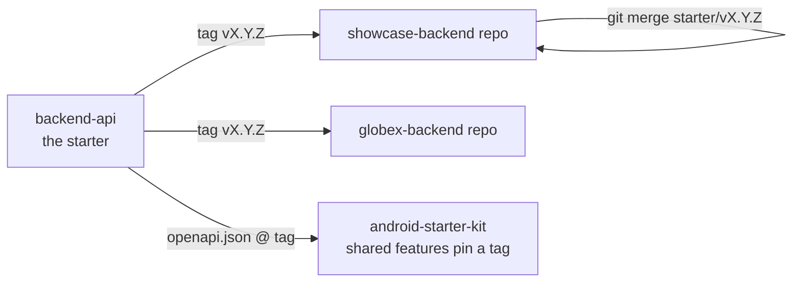

# Backend Starter and Shared Contract — Design

Status: **awaiting approval**. Date: 2026-11-10.
Builds on: [2026-11-09-whitelabel-backend-design.md](./2026-11-09-whitelabel-backend-design.md)
(everything there still holds unless this document changes it).
Android counterpart (source of truth for what Android expects):
`../android-starter-kit/docs/superpowers/specs/2026-11-10-reusable-app-foundation-design.md`.

---

## 0. Intent and the why

The Android repo is now a foundation for building many different apps, and the owner decided
that **each app gets its own backend, created from this repo**. Shared Android features (auth,
home, catalog, profile, settings) call this repo's API directly, with no adapter layer.

So `backend-api` changes role. It is no longer one multi-tenant service. It is **the backend
starter**, and its API contract is a shared dependency of every future app and every backend
created from it. Old Android builds stay installed on phones for months, so contract changes
must never break an installed app.

### Owner decisions (2026-11-10)

| Question | Decision |
|---|---|
| How is a new app's backend created? | **A new repo cloned from this one, keeping a `starter` git remote.** Starter updates arrive with `git merge` of a starter tag. |
| Is shared mode a production option? | **Yes, supported but secondary.** Dedicated is the normal production shape. Shared mode is for local development and for running several small apps cheaply. Nothing is removed. |
| What happens to a breaking change? | **`/api/v1` is extend-only.** A breaking change ships as `/api/v2`, which runs alongside v1. |
| Which Android Phase 4 gaps get built now? | **Both: delete account, and examples in the spec.** |
| How is the work split? | **Two PRs.** `docs/starter-contract` (everything except delete account) and `feat/delete-account`. |
| Delete account semantics | **Hard delete** through the existing cascades. |
| Where do spec examples come from? | **The test fixtures.** Real mapper output on fixed inputs, so an example cannot drift. |
| What does the breaking-change check compare against? | **The PR's base branch spec.** |

### Goals
- A reader understands in one page that this is the starter, and how an app's backend is made from it.
- A new app's backend can be created, extended and kept up to date by following one guide.
- Breaking the shared contract is impossible by accident: CI fails the PR.
- Android Phase 4 has what it needs: spec examples for contract tests, and account deletion.

### Non-goals
- Removing or deprecating shared mode or multi-tenancy.
- Renaming the npm package, or the JWT issuer and audience defaults. Changing the audience would invalidate every issued token, and none of these are visible to users.
- Publishing the contract as a package, or generating clients.
- `/api/v2`. No breaking change is planned.
- Editing `../android-starter-kit`. Android follow-ups go in the PR descriptions.
- Soft delete, account recovery, or a data export endpoint.

### Anti-goals (a failure even if it works)
- Any change to `openapi/openapi.json` that removes, renames or retypes something an installed app uses.
- A starter update that can't merge cleanly into an app's backend because app code was put in starter files by convention.
- Examples in the spec that differ from what the server really returns.

---

## 1. Positioning (PR 1)

- **`README.md`** opens with:
  - "the backend starter each app's backend is created from";
  - that the contract is what shared Android features target;
  - the two modes: dedicated as the normal production shape, shared for local development and for cheaply hosting several small apps.
  - The "white-label" wording goes.
- **`docs/architecture.md`** gains a "Role of this repo" section (the same message plus the update flow diagram below), and its overview is reworded to match.
- **`docs/deployment-shared.md`** gains a short "When to choose shared mode" section.
- **Local development is unchanged:** shared mode, with tenants `acme` (Android app "showcase") and `globex` (Android app "globex"), and the Android debug base URL `http://10.0.2.2:3000/api/v1/`.

## 2. Guide: creating an app's backend (PR 1) — `docs/creating-a-backend.md`

The counterpart of Android's `docs/creating-an-app.md`. Sections, in order:

1. **Create the repo.** Clone the starter at a tag, create a new empty private repo, then:
   - point `origin` at it;
   - rename the starter remote to `starter`;
   - push `main`.

   Show the exact `git` commands. (GitHub can't fork a repo into its own account, so this is a clone, not a fork.)
2. **Make it yours.**
   - Edit `.env` with the dedicated-mode values.
   - Set `DEDICATED_TENANT_SLUG`. It must equal the Android app's `api.tenant` when that is set, and otherwise is any valid slug.
   - Create the single tenant with the tenant CLI, along with its config and flags.
   - Optionally keep the demo catalog, or remove it.
3. **Line it up with the Android app.** A table:

   | Android `app.properties` | Backend |
   |---|---|
   | `api.release.baseUrl` | the deployment's public URL + `/api/v1/` |
   | `api.debug.baseUrl` | local dev URL |
   | `api.tenant` | `DEDICATED_TENANT_SLUG`, or the tenant slug in shared mode |
   | `defaults.features` | the flag keys seeded for the tenant |
   | `defaults.legal.*` / `defaults.support.email` | the tenant's app config (`legal`, `support`) |

4. **Add app-specific features.** Link `docs/adding-a-module.md`, with three rules:
   - App endpoints live under **`/api/v1/x/<feature>/…`**.
   - App code lives in new folders: `src/modules/<feature>/` and `src/app/api/v1/x/<feature>/`.
   - Starter files are touched only at the listed extension points: container wiring, the OpenAPI registration list, seed data, `.env`, and the isolation-matrix rows for the new routes.
5. **Pull starter updates.**
   - `git fetch starter --tags`, then `git merge vX.Y.Z`.
   - `openapi/openapi.json` is generated, so it **will** conflict whenever the app has its own routes. Never hand-merge it: take either side and regenerate (`git checkout --theirs openapi/openapi.json && npm run openapi:generate`), then commit. The same rule applies to `package-lock.json` (`npm install` after the merge).
   - Run the full suite. The breaking-change check runs in the app's own CI against the app's base branch, so it also catches a starter update that changed something the app's Android build relies on.
   - Read the starter's release notes (GitHub release text per tag) for any migration steps.
   - A starter-route change made in an app backend is a fork of the contract. Don't do it: propose the change to the starter instead.
6. **Deploy.** Link `docs/deployment-dedicated.md`.

## 3. Contract stability policy (PR 1) — `docs/contract.md`

**What the contract is:**
- every path under `/api/v1` defined by the starter;
- request and response schemas;
- the envelope;
- error codes and their statuses;
- headers (`Authorization`, `X-Client-Id`, `X-Request-Id`, `Retry-After`, the app-config `Cache-Control` and `Vary`);
- pagination;
- the shared flag keys.

The committed `openapi/openapi.json` is its machine-readable form.

| Allowed in v1 (non-breaking) | Breaking: never in v1, ships as `/api/v2` |
|---|---|
| New endpoint or method | Removing or renaming an endpoint, method or path parameter |
| New optional request field | Making a request field required, or tightening its validation (length, format, enum) |
| New response field | Removing, renaming or retyping a response field, or making it nullable |
| New error code; new enum value **in a response** only if clients degrade (error `code` does: unknown → `UNKNOWN`) | Removing or renaming an error code, or changing a code's status |
| New flag key | Changing a status code for an existing case; changing the envelope; removing a flag key's meaning |
| Loosening validation | Changing a header's meaning |

- **Tags:** `vMAJOR.MINOR.PATCH`.
  - MAJOR equals the API path version (`v1.*` serves `/api/v1`).
  - MINOR is a new contract surface.
  - PATCH has no contract change.
  - Tags are cut on `main` by the owner, with a GitHub release whose notes list contract additions and any migration steps.
  - Android pins a tag. Each app's backend merges tags.
- **App namespace:** the starter never defines routes under `/api/v1/x/`. App backends put all their own endpoints there. A starter-side test enforces this (§5).
- **Deprecation:** a v1 field or endpoint may be marked `deprecated: true` in the spec. It is never removed within v1.

## 4. Shared feature-flag keys (PR 1)

- **Starter-level keys:** `catalog` and `profile`. They are documented in `docs/contract.md` and `docs/api.md`, and exported as a constant (`STARTER_FEATURE_KEYS`) from `src/modules/app-config/`.
- **`TenantAdminService.create`** creates both keys, switched on (today it creates only `catalog`).
- **The seed** ensures both keys exist for every seeded tenant, including tenants already present in a dev database from an earlier seed (an idempotent upsert, since `create` is skipped for existing tenants).
- **Semantics are unchanged:**
  - `features` stays a key → boolean map, and unknown keys are off.
  - `catalog` gates the catalog routes on the server (`FEATURE_DISABLED`).
  - `profile` is **client-side only**. The server does not gate `/users/me` with it, because sign-in and settings need that endpoint.
  - Home, settings and auth have no flag.

## 5. CI guards (PR 1)

- **Breaking-change check.**
  - A CI step on pull requests compares the PR's `openapi/openapi.json` against the copy on the PR's own base branch (`github.base_ref`), obtained with `git show origin/<base>:openapi/openapi.json`.
  - For stacked PRs this is the branch below, which is correct, because each PR is checked against what it lands on.
  - The step is skipped on `push` to `main` (the PR already checked it). `ci.yml` already checks out with `fetch-depth: 0`.
  - If the base has no `openapi/openapi.json` yet, the step passes with a notice.
  - It uses the `oasdiff` GitHub Action (pinned version) in breaking mode and fails on any breaking change.
  - Because the error envelope's `code` is an enum in the spec, removing or renaming an `ErrorCode` fails it.
  - This adds one step to job `ci`, with no npm dependency.
- **Namespace guard.**
  - A unit test, using the existing route discovery in `tests/helpers/routes.ts`, keeps a committed list of the starter's routes, keyed **`METHOD path`** (call), so a new method on an existing path (for example PR 2's `DELETE /users/me`) must be listed too. The list includes `GET /health` and `GET /openapi.json`.
  - It fails if a starter route is added under `x/`, or if a route outside `x/` appears that is not in the list, so a starter change must update the list deliberately.
  - App backends are told (in the guide) to add their routes under `x/`, which the test allows without listing.
- **Error-code guard:** covered by the breaking-change check. No separate test.

## 6. Spec examples (PR 1)

- Every response schema registered in the OpenAPI registry gets an `example`. It is produced by running the real mapper or service on fixed fixture inputs: fixed UUIDs, fixed ISO dates, `alice@shared.test`, and so on.
- The same fixtures feed `tests/unit/openapi/dto-contract.test.ts`, which already parses mapper output against the schemas. That test now also asserts that each registered example equals the fixture output.
- Every request body schema gets a hand-written example. These are validated by a test that `parse`s each example with the route's real request schema.
- The error envelope gets one example per common case: `VALIDATION_ERROR` with details, `UNAUTHENTICATED`, `RATE_LIMITED`.
- Examples must be deterministic. Regenerating the spec stays byte-identical (the existing test).
- Adding examples is non-breaking, and the breaking-change check must pass on this PR.
- **Where the fixtures live (call).**
  - Each module gets a `src/modules/<x>/<x>.examples.ts` that exports fixed fixture inputs and the examples computed from them by the module's real, pure mappers (`toUserDto`, the session and catalog DTO mappers, and so on). Both `scripts/generate-openapi.ts` (via the `*.openapi.ts` registrations) and `dto-contract.test.ts` import these files, so nothing is copied.
  - Where the real output comes from a service rather than a pure mapper (settings, public app config, `me`):
    - extract the pure "build the DTO" step into an exported function if it isn't one already, and compute the example from it;
    - only where that's impossible, use a literal example that the test checks against the real service output on the same fixture.
  - Generation never imports from `tests/` and needs no fakes, database or clock.

## 7. Delete account (PR 2, `feat/delete-account`)

- **`DELETE /api/v1/users/me`**:
  - `auth: "required"`, `tenant: "required"`;
  - body `{password: string 1–128}` (strict) with `Content-Type: application/json`;
  - response 200 `{}`;
  - `operationId: usersDeleteMe`.
- **Flow:**
  1. Verify the password with Argon2. A wrong password returns 401 `INVALID_CREDENTIALS`.
  2. Delete the user row (`tenantId` + `id`).
  3. The existing `onDelete: Cascade` relations remove the user's sessions, refresh tokens (via sessions), reset tokens and settings.
- **After deletion:**
  - The caller's access token fails on the next request: the session is gone, so the session check returns 401.
  - The same email can register again as a new account.
- **Rate limit:** `delete-account` at 5 per 900 s, keyed `${tenantId}|${userId}`, the same shape as `change-password-account`.
- **Isolation:** a new isolation-matrix row. A TENANT_MISMATCH call deletes nothing, and acme alice deleting her account leaves globex alice intact. The completeness test already forces the row.
- **Tests:**
  - unit tests (wrong password, success);
  - integration tests: data really gone (user, sessions, tokens, settings), old access token returns 401, old refresh token returns 401, re-registration works, rate limit;
  - leakage and contract rows.
- **Docs:** `docs/api.md` (the endpoint, Android guidance: confirm with password, then clear local tokens), `docs/contract.md` (listed as a v1 addition), `docs/architecture.md` lifecycle notes.
- **Sequencing (call):** PR 2 branches from `main` after PR 1 has merged, so it builds on PR 1's example conventions, `docs/contract.md` and the route list. Its request body (`{password}`) and its 200 `{}` response get examples under the §6 rules, and it adds `DELETE /users/me` to the namespace guard's starter route list.
- **Data covered (checked against `prisma/schema.prisma`):** the only user-owned tables are `sessions` (and their `refresh_tokens`), `password_reset_tokens` and `user_settings`, all `onDelete: Cascade`. Catalog items, app config and flags are tenant-owned and untouched. There is no audit table. A single `delete` is atomic, and the per-request session check reads the DB, so the next request after deletion returns 401.
- **Why `DELETE` with a body:** it's RFC-permitted, and Ktor and the `route()` pipeline support it. The alternative `POST /users/me/delete` was rejected as non-REST. A proxy that strips DELETE bodies would make the request fail with 400, not delete anything, so the failure is safe.

## 8. Android follow-ups (for the PR descriptions; not done here)

1. Pin the vendored `api/openapi.json` to tag `v1.0.0` once it's cut, instead of a commit SHA.
2. Contract tests can decode the new spec examples (PR 1).
3. Add a "Delete account" action (in settings or profile, needed for Play) calling `DELETE users/me` with password confirmation. After success, clear tokens and move to the auth graph.
4. App-specific Android features call `/api/v1/x/<feature>/…` on their backend.
5. `defaults.features` should list `catalog` and/or `profile` for apps using those features, matching the backend seed.

## Approaches considered

- **Creating backends:** a clone with a `starter` remote (chosen) / a GitHub template repo (no upstream link; fixes copied by hand) / a plain copy.
- **Shared mode:** supported but secondary (chosen) / dev-only.
- **Breaking changes:** extend-only v1 with `/api/v2` for breaks (chosen; protects installed apps) / semver-major breaks with coordinated upgrades.
- **PR split:** two PRs (chosen; the security-sensitive endpoint gets its own review) / one PR.
- **Delete account:** hard delete via cascades (chosen) / soft delete with anonymisation.
- **Examples:** from test fixtures (chosen; can't drift) / hand-written.
- **Breaking-change baseline:** the PR base branch (chosen; works from the first PR) / the last tag.

## Release step (owner)

After PR 1 merges, the owner cuts `v1.0.0` on `main` with release notes. This is the first tag Android and future backends pin. PR 2 ships in `v1.1.0` (a new endpoint is a MINOR change).

## Left to the builder

- Exact wording of the docs.
- The `oasdiff` action version (pinned, at least 2 weeks old).
- Fixture values.
- Where `STARTER_FEATURE_KEYS` lives within `src/modules/app-config/`.
- The committed starter route list's file location.
